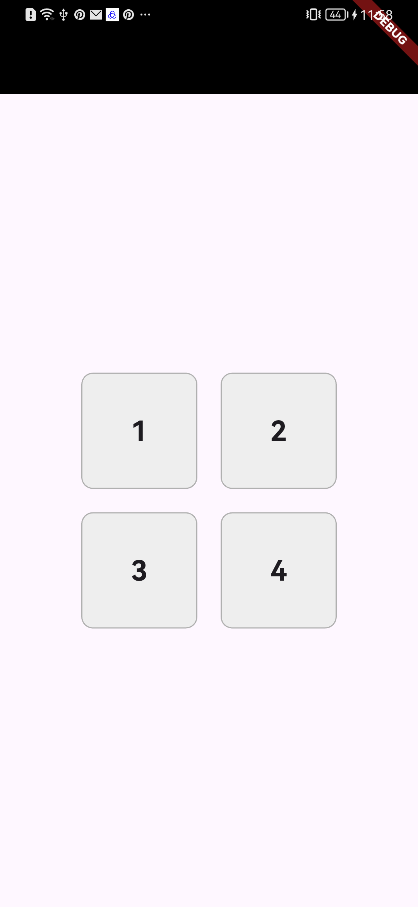

# Flutter UI Elements

A simple Flutter interface displaying a 2×2 grid of numbered boxes.

Developed as part of Elm's Flutter Development Bootcamp.

- **Project Date:** May 6, 2025
- **Technologies:** Dart, Flutter, Material

## Features

- Layout with Row and Column widgets.
- Container styling with borders and rounded corners.

## Getting Started

Open this folder using Android Studio or VS Code with the Flutter extension. Use a Flutter SDK compatible with the original Dart SDK constraint (`^3.7.2`).

```bash
flutter pub get
flutter run
```

Run the included basic tests with `flutter test`.

## Screenshots

<p align="center">
  
</p>
