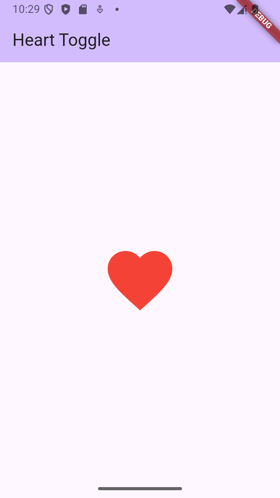
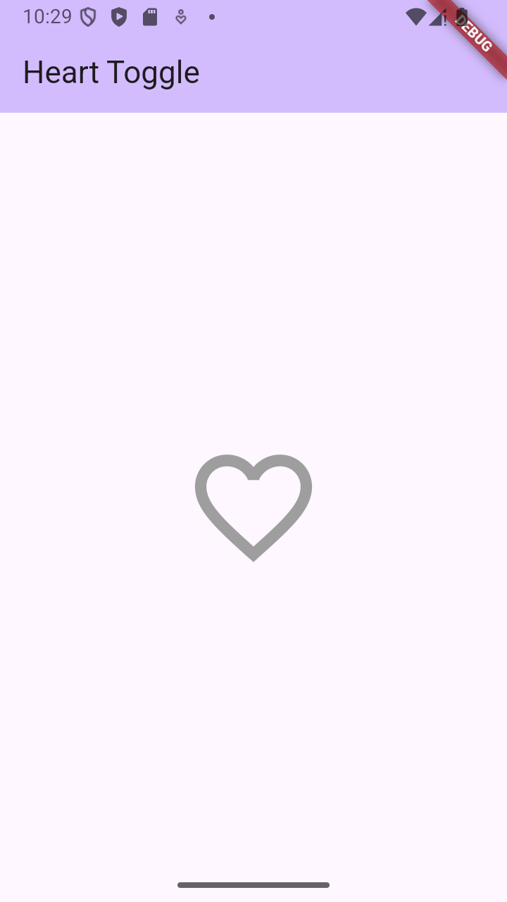

# GetX State Management

A small favorite-toggle exercise using reactive state management with GetX.

Developed as part of Elm's Flutter Development Bootcamp.

- **Project Date:** May 7, 2025
- **Technologies:** Dart, Flutter, GetX

## Features

- Toggle between filled and outlined heart icons.
- Reactive UI updates using Obx and a separate controller.

## Getting Started

Open this folder using Android Studio or VS Code with the Flutter extension. Use a Flutter SDK compatible with the original Dart SDK constraint (`^3.7.2`).

```bash
flutter pub get
flutter run
```

Run the included basic tests with `flutter test`.

## Screenshots

<p align="center">
  
  
</p>
