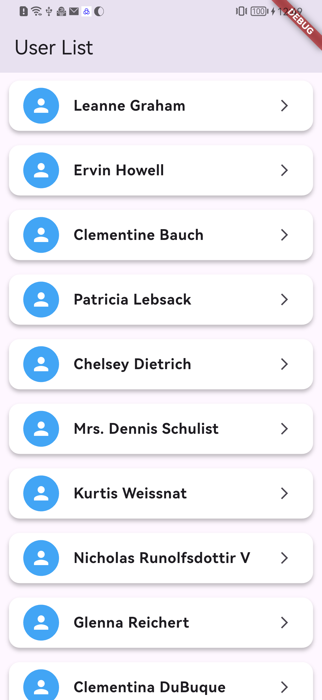

# API Integration

A user-list application that fetches sample user data from JSONPlaceholder.

Developed as part of Elm's Flutter Development Bootcamp.

- **Project Date:** May 11, 2025
- **Technologies:** Dart, Flutter, Dio, REST API

## Features

- Fetch and parse JSON user data with Dio.
- Display loading, error and success states using FutureBuilder.

## Getting Started

Open this folder using Android Studio or VS Code with the Flutter extension. Use a Flutter SDK compatible with the original Dart SDK constraint (`^3.7.2`).

```bash
flutter pub get
flutter run
```

An internet connection is required to access the public JSONPlaceholder API.

Run the included basic tests with `flutter test`.

## Screenshots

<p align="center">
  
</p>
