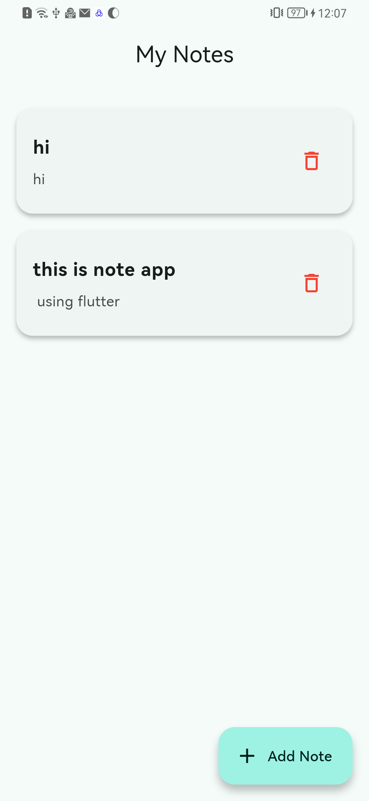
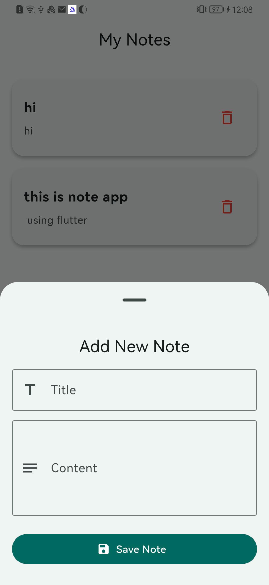

# Local Database App

A local notes application for creating, viewing and deleting notes.

Developed as part of Elm's Flutter Development Bootcamp.

- **Project Date:** May 12, 2025
- **Technologies:** Dart, Flutter, SQLite, sqflite

## Features

- Add notes with a title and content.
- Persist and retrieve notes using SQLite.
- Delete saved notes and display them in a Material 3 interface.

## Getting Started

Open this folder using Android Studio or VS Code with the Flutter extension. Use a Flutter SDK compatible with the original Dart SDK constraint (`^3.7.2`).

```bash
flutter pub get
flutter run
```

Run on Android or iOS with SQLite support.

Run the included basic tests with `flutter test`.

## Screenshots

<p align="center">
  
  
</p>
